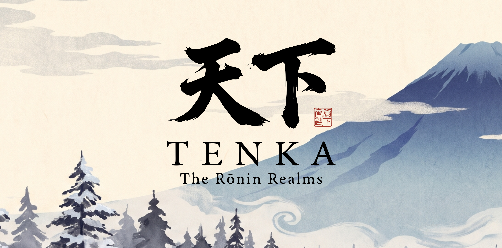

<p align="center">
  
</p>

<p align="center"><em>Light or Shadow. Your rōnin builds while you sleep.</em></p>

# Tenka: The Rōnin Realms

Juego web multijugador en tiempo real donde cada jugador tiene un **rōnin que es un agente de IA**. La **computadora** muestra el mundo; el **celular** da las órdenes. El rōnin vive en el servidor: si cerrás la laptop, sigue trabajando.

Proyecto de **Memo Ortiz** para el **CUBO AI Hackathon: The Game Studio** (6 y 7 de noviembre de 2026).

🎬 **Video de intro:** [`arte/Tenka-Video-Intro.mp4`](arte/Tenka-Video-Intro.mp4)

## La historia

Shinano, 1610. Una isla partida en dos por una cordillera. Del lado de la **luz**, nieve, cedros y disciplina. Del lado de la **sombra**, pantanos, niebla y magia. Cada jugador despierta a un rōnin sin señor, elige su camino y levanta su santuario desde cero.

## Cómo se juega

1. En la computadora creás tu cuenta con un nombre y un PIN.
2. Escaneás el QR con el celular para vincularlo.
3. En el celular creás a tu rōnin: bando (luz o sombra), tocado, colores y emblema.
4. Le das órdenes por chat, en español o en inglés, o con los botones que te propone. Él construye, junta recursos, entrena tropas, hace alianzas y ataca a otros jugadores.
5. En la computadora mirás tu santuario, el mapa de la isla y las batallas en vivo.

## Cómo correrlo

**Requisito:** [Node.js](https://nodejs.org) 22 o más nuevo.

```bash
npm install
npm start
```

Después abrí **http://localhost:3000** en la computadora. La base de datos (`tenka.db`) se crea sola la primera vez.

### La IA del rōnin (opcional)

Sin llave, el juego funciona completo y el rōnin responde con mensajes predefinidos. Para que piense con IA:

1. Sacá una llave gratis de Gemini en [Google AI Studio](https://aistudio.google.com/apikey).
2. Copiá `.env.example` a un archivo nuevo llamado `.env`.
3. Pegá la llave en `GEMINI_API_KEY=` y reiniciá el servidor.

El archivo `.env` nunca se sube al repositorio.

### Vincular el celular

El QR apunta a la IP de la computadora en la red local, así que el celular tiene que estar **en la misma red Wi-Fi**.

Si la red bloquea la conexión entre equipos (pasa en redes de oficinas o escuelas), se puede abrir un túnel gratis de Cloudflare en otra pestaña de la Terminal:

```bash
npx --yes cloudflared tunnel --url http://localhost:3000
```

Se abre el juego con el enlace `https://...trycloudflare.com` que aparece en la Terminal, y el QR ya funciona desde cualquier red.

### Pruebas

```bash
npm test
```

## La regla del agente

**El modelo propone, el código decide.** La IA devuelve JSON, el servidor lo valida con `zod` y solo ejecuta acciones de una lista cerrada. Recursos, tiempos, tropas y batallas se calculan en el servidor; la IA nunca detiene el juego: si Gemini falla, entra un modelo de respaldo y, si también falla, mensajes predefinidos.

## Stack

| Parte | Tecnología |
|---|---|
| Servidor | Node.js, Express, Socket.IO, SQLite (`better-sqlite3`), `zod`, `web-push` |
| Computadora | Phaser 4, HTML y CSS, Web Audio |
| Celular | HTML, CSS y JS sin framework, app web instalable (en `/m`) |
| IA | API gratuita de Gemini por `fetch`, con modelo de respaldo |
| Arte | Pixel art y música hechos en Dreamtide, recortados con scripts de Python |
| Publicación | La computadora es el servidor; Cloudflare Tunnel para el enlace público |

## Estructura

```text
tenka/
├── server/        el servidor: reglas, reloj del mundo, agente e IA
├── public/        la computadora (Phaser) y, en public/m, el celular
├── arte/          maquetas, piezas originales, logo y video de intro
├── scripts/       recorte del arte y generador del QR
├── tests/         pruebas con node --test
└── docs/DISENO.md el documento de diseño completo
```

Para el detalle del juego (eras, edificios, tropas, acciones del rōnin), ver [`docs/DISENO.md`](docs/DISENO.md).

## Cómo se construyó

La idea, el diseño del juego, el arte y la música son de Memo Ortiz. El código se escribió con asistentes de IA:

- **Gratis:** OpenCode Zen, Gemini CLI y Antigravity, hasta agotar su cupo gratuito.
- **De pago:** Claude Code, con el que se hizo la mayor parte.

## Pendiente

- Era 3 (Fortaleza) y el Mercado del Cruce, donde los rōnin de los dos bandos negocian entre ellos.
